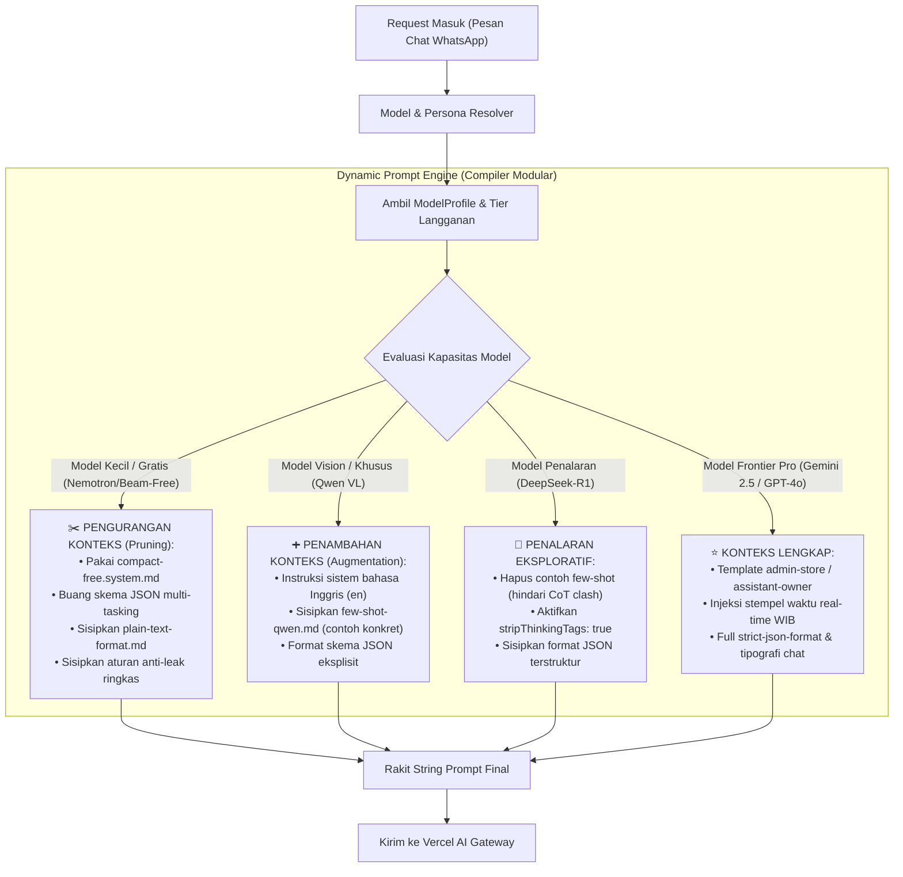

# Cetak Biru Arsitektur & Rencana Implementasi: Persona Bot, Dynamic Prompt Engine, & Pemilihan Model AI

**Versi:** 2.0.0 (Revisi Arsitektural Menyeluruh)  
**Status Dokumen:** Menunggu Review & Persetujuan Pengguna (*Draft Proposal*)  
**Kepatuhan:** 100% Patuh pada [AGENTS.md](file:///d:/Project-Sync-Enbee/meseid/AGENTS.md) (File-Level SRP, Batas < 400 Baris, Zero Bypass)

---

## 1. Latar Belakang & Evaluasi Masalah Arsitektur Sebelumnya

Berdasarkan audit teknis dan masukan kritis, terdapat dua kelemahan fundamental pada implementasi terdahulu yang wajib dirombak total:

1. **Anti-Pattern String Prompt di Dalam Kode TypeScript (*Hardcoded Prompt Strings*):**
   - Sebelumnya, teks prompt ratusan baris dicampurkan langsung di dalam fungsi TypeScript (`persona-prompt.builder.ts`).
   - Hal ini melanggar *Separation of Concerns* (SRP), membuat berkas program membengkak, dan menyulitkan pemeliharaan berkala.
   - **Solusi Baru:** Menerapkan standar industri *Prompt-as-Code* di mana seluruh teks prompt dieksternalisasi ke dalam berkas **Markdown (`.md`)** modular terpisah.

2. **Ketiadaan Adaptor Template Dinamis (Konteks Statis Seragam untuk Semua AI):**
   - Sebelumnya, satu template raksasa yang sama dipaksakan ke seluruh model AI tanpa membedakan kapasitas kognitif model.
   - Akibatnya, model gratis berkapasitas kecil (seperti `nvidia/nemotron-free`) gagal (*score 56.9%*) karena mengalami kebingungan (*context dilution*) saat dipaksa menghasilkan skema JSON dan teks panjang sekaligus.
   - **Solusi Baru:** Menerapkan **Dynamic Context Adaptation Engine** yang secara cerdas melakukan **Pengurangan Konteks (*Pruning*)** untuk model kecil dan **Penambahan Konteks (*Augmentation/Few-Shot*)** untuk model khusus/vision.

3. **Pemberantasan Svelte 5 Circular Reactivity (Pencegahan 500 Internal Error):**
   - Menghapus mutasi `$state` di dalam `$effect` yang menyebabkan *circular update loop* (`Maximum update depth exceeded`) saat hidrasi SSR. Menetapkan aturan baku penggunaan `$derived` murni.

4. **Kepatuhan Murni Data Dinamis (Zero Hardcoding):**
   - Seluruh konten Knowledge Base dan identitas personalisasi 100% diinput manual oleh pengguna dari database PostgreSQL (`knowledge_base` dan `bot_configs`), tanpa ada data uji coba fiktif di aplikasi produksi.

---

## 2. Arsitektur Dynamic Prompt Engine (Eksternalisasi Markdown Modular)

Struktur berkas backend baru di bawah `apps/api/src/adapters/ai/prompts/`:

```
apps/api/src/adapters/ai/prompts/
├── templates/
│   ├── admin-store.system.md         <- Template utama Admin Toko (Frontier Pro)
│   ├── assistant-owner.system.md     <- Template utama Asisten Pemilik (Frontier Pro)
│   └── compact-free.system.md        <- Template ringkas minimalis (Model Gratis/Kecil)
├── partials/
│   ├── temporal-wib.md               <- Stempel waktu server real-time WIB
│   ├── strict-json-format.md         <- Skema JSON terstruktur murni
│   ├── plain-text-format.md          <- Format percakapan teks santun bebas JSON
│   ├── anti-leak-guard.md            <- Guardrail larangan membocorkan modal/brankas
│   ├── owner-trust-access.md         <- Izin akses data modal/margin untuk Owner
│   └── few-shot-qwen.md              <- Contoh konkret zero/few-shot untuk model asing
├── prompt.types.ts                   <- Definisi tipe parameter template (< 40 baris)
└── prompt-engine.ts                  <- Compiler perakit modular (< 80 baris, File-Level SRP)
```

### Mekanisme Adaptasi Konteks Dinamis Berdasarkan `ModelProfile`:



#### Tabel Matriks Adaptasi Konteks per Kategori Model:
| Kategori Model | Model Contoh | Strategi Konteks | Modul Prompt yang Disusun |
|---|---|---|---|
| **Frontier Pro (LMM/VLM)** | `google/gemini-2.5-flash`, `openai/gpt-4o`, `openai/gpt-4o-mini` | **Konteks Penuh** | `admin/assistant.system.md` + `temporal-wib.md` + `strict-json-format.md` + `anti-leak-guard.md` |
| **Model Gratis Ringan** | `nvidia/nemotron-3.5-lightning-free`, `reflection/beam-free` | **Konteks Ringkas (*Pruning*)** | `compact-free.system.md` + `plain-text-format.md` + `temporal-wib.md` *(Tanpa JSON ganda yang membebani)* |
| **Model Multimodal Asing** | `alibaba/qwen3-vl-instruct` | **Penambahan Konteks (*Few-Shot*)** | `admin/assistant.system.md` (English System) + `few-shot-qwen.md` + `strict-json-format.md` |
| **Model Penalaran Murni** | `deepseek/deepseek-r1` | **Struktural Bersih (Anti CoT Clash)** | `admin/assistant.system.md` + `strict-json-format.md` *(Tanpa few-shot, strip `<think>`)* |

---

## 3. Spesifikasi Pemilihan Model AI Berdasarkan Hak Akses Langganan

### Aturan Bisnis & Penegakan Tingkat Langganan:
1. **🌱 Akun Gratis (*Free Tier*):**
   - Hanya memiliki izin memilih model dari kategori **Gratis** (`reflection/beam-free`, `nvidia/nemotron-free`, `reflection/beam`).
   - Model Berbayar (Pro) berstatus **Terkunci** secara visual di UI (badge `🔒 Perlu Pro`, sakelar dinonaktifkan / `disabled`).
   - Jika pengguna Gratis mencoba menembus request simpan ke backend, endpoint `PUT /api/owner/personalisasi` langsung menggagalkan dengan status **HTTP 403 `TIER_INSUFFICIENT`**.
2. **👑 Akun Pro (*Pro Tier*):**
   - Memiliki izin penuh memilih **seluruh model** (baik Gratis maupun Berbayar).
3. **Pilihan Otomatis Cerdas (*Smart Auto-Select*):**
   - Pengguna dapat menyalakan sakelar *"Pilih Bot secara Otomatis"*.
   - Jika akun Pro: otomatis menyetel model terbaik `google/gemini-2.5-flash` (atau `openai/gpt-4o-mini`).
   - Jika akun Gratis: otomatis menyetel model gratis terbaik `reflection/beam-free`.

### Katalog Model AI Teruji yang Ditampilkan di UI:
Tabel UI hanya menampilkan model yang telah terbukti lulus benchmark empiris kita pada Vercel AI Gateway:
- **Model Berbayar (Pro):**
  1. `google/gemini-2.5-flash` — LMM, Skor: **97.9%**, Badge: `Rekomendasi Utama`
  2. `openai/gpt-4o-mini` — LMM, Skor: **96.1%**, Badge: `Tercepat & Hemat`
  3. `anthropic/claude-haiku-4.5` — LMM, Skor: **97.1%**, Badge: `Akurat & Cepat`
  4. `openai/gpt-4o` — VLM, Skor: **97.9%**, Badge: `Multimodal Vision`
  5. `deepseek/deepseek-r1` — LLM, Skor: **96.7%**, Badge: `Penalaran Mendalam`
  6. `alibaba/qwen3-vl-instruct` — VLM, Skor: **90.0%**, Badge: `Vision Multimodal`
  7. `anthropic/claude-sonnet-4.6` — VLM, Skor: **90.2%**, Badge: `Hybrid Reasoning`
- **Model Gratis (Free):**
  1. `reflection/beam-free` — LMM, Skor: **95.5%**, Badge: `Juara Gratis`
  2. `nvidia/nemotron-3.5-lightning-free` — LLM, Skor: **94.0%**, Badge: `Gratis Percakapan`
  3. `reflection/beam` — LLM, Skor: **92.0%**, Badge: `Cadangan Gratis`

---

## 4. Struktur Berkas & Pembagian Kerja (Kepatuhan Penuh AGENTS.md)

Sesuai aturan batas keras (< 400 baris per file) dan "1 berkas = 1 fungsi operasi":

### Backend (`apps/api`):
1. `src/adapters/ai/prompts/templates/*.md`: Menyimpan teks template sistem murni.
2. `src/adapters/ai/prompts/partials/*.md`: Menyimpan fragmen instruksi modular.
3. `src/adapters/ai/prompts/prompt-engine.ts` (± 75 baris): Perakit teks prompt yang membaca berkas `.md` secara efisien dan mengisi variabel `{{businessName}}`, `{{knowledgeBase}}`, dll.
4. `src/modules/owner/personalisasi/model-access.guard.ts` (± 180 baris): Pemeriksa hak akses langganan dan penyedia katalog model teruji.
5. `src/modules/owner/personalisasi/actions/update-personalisasi.action.ts` (± 60 baris): Penyimpan `selected_model_id` ke database.

### Frontend (`apps/web`):
1. `src/panels/users/persona-bot/persona-bot.constants.ts` (± 110 baris): Daftar konstanta model teruji beserta skor dan tipenya.
2. `src/panels/users/persona-bot/persona-bot.types.ts` (± 25 baris): Interface tipe data model dan konfigurasi persona.
3. `src/panels/users/persona-bot/components/AiModelSelectionCard.svelte` (± 240 baris):
   - Tabel model interaktif (status, nama, skor uji, jenis, tipe).
   - Hak akses aman SSR menggunakan `$derived` (bebas dari error loop `$effect`).
   - Paginasi 5 item per halaman.
4. `src/panels/users/persona-bot/PersonaBotRoot.svelte` (± 90 baris):
   - Mengambil data persona tersimpan dari API `GET /api/owner/personalisasi`.
   - Mengirim perubahan nama bot dan arahan ke API `PUT /api/owner/personalisasi`.
5. `src/panels/users/knowledge-base/components/AddEntryModal.svelte` (± 130 baris):
   - Formulir bersih tanpa tombol preset toko uji coba (input manual murni).

---

## 5. Rencana Pengujian & Kriteria Kelulusan (Verification Protocol)

1. **Pengujian Reaktivitas Frontend (Eliminasi 500 Error):**
   - Halaman `localhost/dashboard?tab=persona-bot` dimuat langsung di browser tanpa menampilkan layar putih ataupun pesan `500 Internal Error`.
   - Menjalankan `bun run check` pada `apps/web` dengan hasil: `0 errors, 0 warnings`.
2. **Pengujian Penegakan Hak Akses Langganan:**
   - Unit test Bun memastikan pengguna Paket Gratis **dilarang** mengaktifkan model Berbayar (HTTP 403 `TIER_INSUFFICIENT`).
   - Pengguna Paket Pro dapat mengaktifkan model Gratis maupun Berbayar.
3. **Pengujian Dynamic Prompt Engine:**
   - Memastikan saat model `nvidia/nemotron-free` dipanggil, prompt yang dihasilkan adalah versi ringkas (*compact plain text* tanpa skema JSON berat).
   - Memastikan saat model `google/gemini-2.5-flash` dipanggil, prompt yang dihasilkan adalah versi lengkap dengan skema JSON dan stempel waktu WIB.
4. **Verifikasi Kerapian & Batas Baris:**
   - Memastikan tidak ada berkas `.ts` atau `.svelte` yang melebihi 400 baris.
   - Seluruh teks prompt tersimpan rapi di berkas `.md`.
