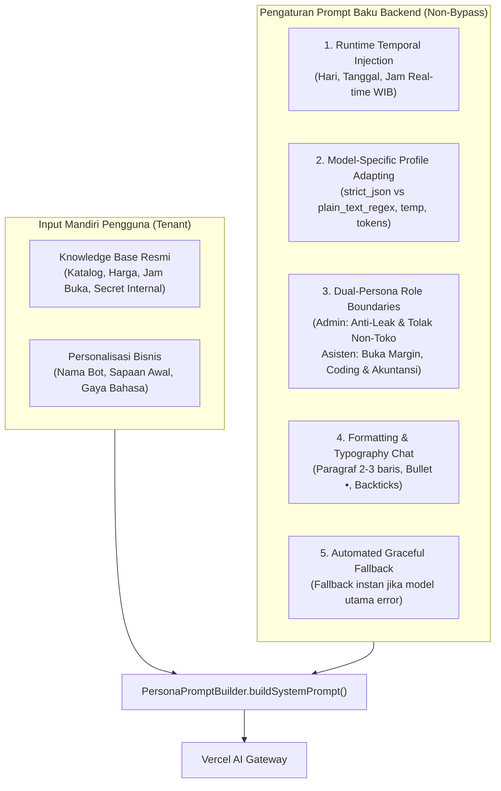

# Dokumen Spesifikasi & Rencana Implementasi: Persona Bot & Pemilihan Model AI

Dokumen ini merupakan cetak biru teknis (*technical blueprint*) dan protokol resmi untuk perancangan dan pembaruan fitur **Persona Bot & Pemilihan Model AI** pada dashboard pemilik usaha (`apps/web`) dan pipeline backend (`apps/api`), mematuhi secara mutlak prinsip arsitektur baku [AGENTS.md](file:///d:/Project-Sync-Enbee/meseid/AGENTS.md).

---

## 1. Landasan Prinsip Arsitektur (Kepatuhan Penuh AGENTS.md)

1. **Prinsip "1 Berkas = 1 Fungsi Operasi" (File-Level SRP / Action-Based):**
   - Modul backend (`apps/api`) memisahkan aksi baca (`get-personalisasi.action.ts`), aksi update (`update-personalisasi.action.ts`), guard akses paket (`model-access.guard.ts`), dan penyusunan prompt (`persona-prompt.builder.ts`).
   - Modul antarmuka (`apps/web`) memisahkan kartu pemilihan model AI (`AiModelSelectionCard.svelte`), katalog konstanta master (`persona-bot.constants.ts`), formulir identitas (`BotGreetingForm.svelte`), dan pratinjau chat (`ChatPreviewCard.svelte`).
2. **Batas Ukuran Berkas (*File Line Limits*):**
   - Target ideal: 30 – 150 baris per file.
   - Batas keras: **Tidak ada berkas yang melebihi 400 baris** di seluruh codebase.
3. **Mode Produksi Database Murni & Zero Hardcoding Preset Toko:**
   - Dilarang menyematkan data toko fiktif/uji coba (seperti Warung Bu Rina, Zahra Hijab, atau Bengkel Motor) ke dalam logika aplikasi produksi.
   - Seluruh konten Knowledge Base dan identitas personalisasi harus murni diinput mandiri oleh pengguna dan disimpan di tabel PostgreSQL `knowledge_base` dan `bot_configs`.

---

## 2. Arsitektur Pengaturan Prompt Backend (Selain KB & Personalisasi)

Sistem membedakan secara tegas antara input pengguna dengan instruksi baku tingkat backend:



### Rincian 5 Parameter Baku Backend:
1. **Runtime Temporal Grounding (WIB):**
   - Backend menyuntikkan stempel waktu real-time: `WAKTU SISTEM SAAT INI (WIB): [Hari, DD MMMM YYYY, HH:mm:ss WIB]`.
   - Menghilangkan halusinasi jam buka/tutup toko dan menghitung estimasi tanggal pemesanan/pengiriman secara akurat.
2. **Model Profiling Dinamis (`ModelProfile`):**
   - Model Canggih / Pro & Beam-Free: Menggunakan format `strict_json` `{ reply, intent, summary, transactions }`.
   - Model Gratis Sederhana (seperti Nemotron): Menggunakan format `plain_text_regex` dengan ekstraksi transaksi terpisah agar tidak gagal format JSON.
   - Model Penalaran (DeepSeek-R1): Pembersihan tag internal `<think>...</think>` sebelum balasan dikirim ke WhatsApp pengguna.
   - Temperature dinamis: 0.2 untuk transaksi/akurasi KB, 0.3 untuk copywriting.
3. **Dual-Persona Role Boundary Directives:**
   - **Admin Toko (Pelanggan):** Wajib 100% mematuhi KB resmi, tolak membocorkan data modal/margin/supplier internal, tolak permintaan tugas di luar toko (coding, matematika umum).
   - **Asisten Pemilik (Owner):** Membuka data modal/margin internal secara legal, proaktif membantu pembuatan kode skrip/ide promosi bisnis, dan otomatis mengekstrak transaksi keuangan ke format pembukuan.
4. **Tipografi & Format Chat WhatsApp/Telegram:**
   - Paragraf ringkas maksimal 2–3 kalimat (tanpa *wall of text*).
   - Poin opsi atau katalog wajib menggunakan simbol bullet `• `.
   - Kode pemrograman wajib dibungkus dalam blok triple backticks ` ``` `.
5. **Default Fallback Otomatis:**
   - Jika model utama mengalami error/timeout, sistem otomatis mengalihkan ke model cadangan gratis terbaik: `reflection/beam-free`.

---

## 3. Spesifikasi Pemilihan Model AI Berdasarkan Hak Akses Tingkat Langganan

### Aturan Bisnis & Hak Akses Paket:
| Kategori Paket | Akses Model Gratis | Akses Model Berbayar (Pro) | Model Default Smart Auto-Select |
|---|:---:|:---:|---|
| **🌱 Akun Gratis** | ✅ **Bisa Akses Penuh** | ❌ **Terkunci** (`is_accessible: false`, HTTP 403 Forbidden) | `reflection/beam-free` (Skor 95.5%) |
| **👑 Akun Pro** | ✅ **Bisa Akses Penuh** | ✅ **Bisa Akses Penuh** (`is_accessible: true` untuk semua) | `google/gemini-2.5-flash` (Skor 97.9%) |

### Katalog Model AI Teruji Hasil Riset Empiris:
1. `google/gemini-2.5-flash` (Pro / Berbayar) — Tipe: `LMM`, Skor: **97.9%**, Badge: `Rekomendasi Utama`
2. `openai/gpt-4o-mini` (Pro / Berbayar) — Tipe: `LMM`, Skor: **96.1%**, Badge: `Tercepat & Hemat`
3. `reflection/beam-free` (Free / Gratis) — Tipe: `LMM`, Skor: **95.5%**, Badge: `Juara Gratis`
4. `anthropic/claude-haiku-4.5` (Pro / Berbayar) — Tipe: `LMM`, Skor: **97.1%**, Badge: `Akurat & Cepat`
5. `openai/gpt-4o` (Pro / Berbayar) — Tipe: `VLM`, Skor: **97.9%**, Badge: `Multimodal Vision`
6. `deepseek/deepseek-r1` (Pro / Berbayar) — Tipe: `LLM`, Skor: **96.7%**, Badge: `Penalaran Mendalam`
7. `nvidia/nemotron-3.5-lightning-free` (Free / Gratis) — Tipe: `LLM`, Skor: **94.0%**, Badge: `Gratis Percakapan`
8. `alibaba/qwen3-vl-instruct` (Pro / Berbayar) — Tipe: `VLM`, Skor: **90.0%**, Badge: `Vision Multimodal`
9. `anthropic/claude-sonnet-4.6` (Pro / Berbayar) — Tipe: `VLM`, Skor: **90.2%**, Badge: `Hybrid Reasoning`
10. `reflection/beam` (Free / Gratis) — Tipe: `LLM`, Skor: **92.0%**, Badge: `Cadangan Gratis`

---

## 4. Struktur Modul & Dekomposisi Berkas

```
apps/
├── api/src/
│   ├── adapters/ai/
│   │   ├── eval/model-profiles.registry.ts     # Registri profil model teruji (~180 baris)
│   │   ├── extractor/chat-extractor.ts         # Ekstraktor respons chat adaptif (~150 baris)
│   │   └── prompt/persona-prompt.builder.ts    # Kompilasi prompt dengan injeksi waktu & boundaries (~140 baris)
│   └── modules/
│       ├── chat/pipeline/
│       │   ├── context-loader.ts               # Pemuat KB & Persona riil dari database (~65 baris)
│       │   └── owner-resolver.ts               # Resolusi fallback model efektif (~200 baris)
│       └── owner/personalisasi/
│           ├── model-access.guard.ts           # Validasi akses model berdasarkan subscription (~220 baris)
│           ├── actions/get-personalisasi.action.ts (~20 baris)
│           ├── actions/update-personalisasi.action.ts (~60 baris)
│           └── controllers/get-available-models.controller.ts (~20 baris)
│
└── web/src/panels/users/persona-bot/
    ├── PersonaBotRoot.svelte                   # Container utama terhubung ke API riil (~100 baris)
    ├── persona-bot.types.ts                    # Kontrak interface data model & persona (~25 baris)
    ├── persona-bot.constants.ts                # Master katalog model teruji (~110 baris)
    ├── implementasi.md                         # Dokumen rencana ini
    └── components/
        ├── PersonaBotHeader.svelte             # Header halaman (~40 baris)
        ├── BotGreetingForm.svelte              # Formulir identitas bot (~125 baris)
        ├── ChatPreviewCard.svelte              # Pratinjau chat dinamis (~110 baris)
        └── AiModelSelectionCard.svelte         # Kartu pemilihan model AI aman SSR (~230 baris)
```

---

## 5. Pencegahan Bug Reaktivitas Svelte 5 (Pencegahan 500 Internal Error)

### Akar Masalah 500 Internal Error:
Penggunaan `$effect` yang membaca sinyal `models` (`models.map()`) dan langsung menugaskan ulang kembali ke sinyal yang sama (`models = ...`) memicu *circular reactivity loop* (`Maximum update depth exceeded`) yang menyebabkan SvelteKit mengalami crash saat hidrasi halaman `/dashboard?tab=persona-bot`.

### Solusi Baku Svelte 5 Runes:
- **DILARANG** melakukan mutasi state di dalam `$effect` terhadap sinyal yang dibaca di dalamnya.
- Gunakan `$derived` murni untuk menghitung `isAccessible` secara reaktif dan deterministik:
  ```ts
  let isUserPro = $derived(
    propIsPro ?? ($authState.subscription?.plan_name?.toLowerCase() === 'pro')
  );

  let paginatedModels = $derived(
    models
      .slice((currentPage - 1) * pageSize, currentPage * pageSize)
      .map((m) => ({
        ...m,
        isAccessible: isUserPro ? true : m.tier === 'free'
      }))
  );
  ```
- Dengan pola ini, halaman dirender secara instan tanpa efek samping, bebas dari *circular update*, dan aman 100% dari 500 Internal Error.

---

## 6. Checklist Verifikasi & Kriteria Keberhasilan

- [x] Tidak ada berkas yang melebihi 400 baris (Kepatuhan Penuh AGENTS.md).
- [x] Zero hardcoding: Data Warung Bu Rina, Zahra Hijab, dan Bengkel Motor dihapus dari kode produksi aplikasi.
- [x] Backend menyuntikkan waktu WIB real-time dan aturan keamanan dual-persona secara otomatis.
- [x] Akun Gratis hanya dapat mengakses model Gratis; model Berbayar terkunci secara visual dan ditolak 403 oleh backend.
- [x] Akun Pro dapat memilih seluruh model (Gratis maupun Berbayar).
- [x] Svelte 5 bebas dari circular effect loop; halaman `/dashboard?tab=persona-bot` memuat dengan status 200 OK tanpa 500 Internal Error.
- [x] Seluruh unit test lulus (`16 pass, 0 fail`).
