# Meseid Database Entity-Relationship Diagram (ERD)

This document provides the canonical Mermaid Entity-Relationship diagram and schema definition for the **Meseid Multi-Tenant Database Layer** (PostgreSQL 16), automatically generated from the live database catalog.

```mermaid
erDiagram
    owners ||--o{ accounts : "owner_id"
    users ||--o{ admin_audit_log : "admin_id"
    owners ||--o{ audit_log : "owner_id"
    users ||--o{ audit_log : "user_id"
    owners ||--o{ bookings : "owner_id"
    schedules ||--o{ bookings : "schedule_id"
    owners ||--o{ bot_configs : "owner_id"
    ai_models ||--o{ bot_configs : "selected_model_id"
    jurnal_baris ||--o{ buku_pembantu : "journal_line_id"
    owners ||--o{ buku_pembantu : "owner_id"
    parties ||--o{ buku_pembantu : "party_id"
    owners ||--o{ channel_connections : "owner_id"
    owners ||--o{ channel_link_codes : "owner_id"
    owners ||--o{ chat_logs : "owner_id"
    users ||--o{ document_versions : "created_by"
    documents ||--o{ document_versions : "document_id"
    owners ||--o{ documents : "owner_id"
    owners ||--o{ google_connections : "owner_id"
    owners ||--o{ inbound_messages : "owner_id"
    accounts ||--o{ jurnal_baris : "account_id"
    jurnal_umum ||--o{ jurnal_baris : "journal_id"
    owners ||--o{ jurnal_baris : "owner_id"
    users ||--o{ jurnal_umum : "created_by"
    owners ||--o{ jurnal_umum : "owner_id"
    jurnal_umum ||--o{ jurnal_umum : "reverses_journal_id"
    owners ||--o{ knowledge_base : "owner_id"
    users ||--o{ owners : "user_id"
    owners ||--o{ parties : "owner_id"
    owners ||--o{ payment_history : "owner_id"
    owners ||--o{ pending_actions : "owner_id"
    plans ||--o{ plan_prices : "plan_id"
    owners ||--o{ quota_counters : "owner_id"
    owners ||--o{ reminders : "owner_id"
    schedules ||--o{ reminders : "schedule_id"
    owners ||--o{ schedules : "owner_id"
    owners ||--o{ subscriptions : "owner_id"
    plans ||--o{ subscriptions : "plan_id"
    owners ||--o{ token_topups : "owner_id"
    owners ||--o{ token_usage_logs : "owner_id"
    owners ||--o{ unanswered_questions : "owner_id"
    knowledge_base ||--o{ unanswered_questions : "resolved_by_kb_id"

    accounts {
        uuid id PK
        uuid owner_id FK
        text code
        text name
        text type
        text normal_balance
        bool is_cash
        bool active
        timestamptz created_at
        timestamptz updated_at
    }

    admin_audit_log {
        uuid id PK
        uuid admin_id FK "nullable"
        uuid target_owner_id FK "nullable"
        text action
        text reason
        jsonb metadata
        timestamptz created_at
    }

    ai_models {
        uuid id PK
        text provider
        text model_id FK
        text tier
        text currency
        bool enabled
        numeric price_input_per_1m
        numeric price_output_per_1m
        timestamptz created_at
        timestamptz updated_at
    }

    alerts {
        uuid id PK
        text severity
        text title
        text description
        text status
        timestamptz created_at
        timestamptz updated_at
    }

    audit_log {
        uuid id PK
        uuid owner_id FK "nullable"
        uuid user_id FK "nullable"
        text action
        text table_name
        uuid record_id FK "nullable"
        jsonb details  "nullable"
        timestamptz created_at
    }

    bookings {
        uuid id PK
        uuid owner_id FK
        text customer_name
        text customer_phone
        text service_name
        timestamptz requested_start_at
        timestamptz requested_end_at
        text status
        uuid schedule_id FK "nullable"
        text notes  "nullable"
        timestamptz created_at
        timestamptz updated_at
    }

    bot_configs {
        uuid id PK
        uuid owner_id FK
        text assistant_bot_name
        text assistant_persona_prompt  "nullable"
        text admin_bot_name
        text admin_persona_prompt  "nullable"
        text persona_prompt  "nullable"
        text selected_model_id FK "nullable"
        text customer_access_mode
        jsonb allowed_contacts
        jsonb allowed_groups
        bool auto_reply_enabled
        jsonb business_hours
        timestamptz created_at
        timestamptz updated_at
    }

    buku_pembantu {
        uuid id PK
        uuid owner_id FK
        uuid party_id FK
        uuid journal_line_id FK "nullable"
        date due_date  "nullable"
        numeric amount
        numeric settled_amount
        text status
        timestamptz created_at
        timestamptz updated_at
    }

    channel_connections {
        uuid id PK
        uuid owner_id FK
        text channel
        text external_account_id FK
        text status
        text session_ref  "nullable"
        bytea credentials_enc  "nullable"
        timestamptz created_at
        timestamptz updated_at
    }

    channel_link_codes {
        uuid id PK
        uuid owner_id FK
        text channel
        text target_external_id FK
        text code_hash
        timestamptz expires_at
        timestamptz used_at  "nullable"
        timestamptz created_at
    }

    chat_logs {
        uuid id PK
        uuid owner_id FK
        text channel
        text external_sender_id FK
        text summary
        text intent  "nullable"
        text sentiment  "nullable"
        timestamptz created_at
    }

    default_accounts_template {
        text business_type
        text code
        text name
        text type
        text normal_balance
        bool is_cash
    }

    document_versions {
        uuid id PK
        uuid document_id FK
        int4 version_no
        text drive_revision_id FK "nullable"
        text checksum  "nullable"
        uuid created_by  "nullable"
        timestamptz created_at
    }

    documents {
        uuid id PK
        uuid owner_id FK
        text kind
        text title
        text drive_file_id FK
        text mime
        timestamptz created_at
        timestamptz updated_at
    }

    google_connections {
        uuid id PK
        uuid owner_id FK
        _text scopes
        bytea refresh_token_enc  "nullable"
        bytea access_token_enc  "nullable"
        timestamptz token_expires_at  "nullable"
        text calendar_id FK "nullable"
        text drive_root_folder_id FK "nullable"
        text status
        timestamptz created_at
        timestamptz updated_at
    }

    inbound_messages {
        uuid id PK
        text channel
        text external_message_id FK
        uuid owner_id FK "nullable"
        text sender_id FK
        text payload_hash  "nullable"
        text status
        timestamptz created_at
        timestamptz updated_at
    }

    jurnal_baris {
        uuid id PK
        uuid journal_id FK
        uuid owner_id FK
        uuid account_id FK
        numeric debit
        numeric credit
        text memo  "nullable"
        timestamptz created_at
    }

    jurnal_umum {
        uuid id PK
        uuid owner_id FK
        date tx_date
        text description
        text source
        text source_ref  "nullable"
        text kind
        uuid reverses_journal_id FK "nullable"
        uuid created_by  "nullable"
        timestamptz created_at
        timestamptz updated_at
    }

    knowledge_base {
        uuid id PK
        uuid owner_id FK
        text category
        text title
        text content
        timestamptz created_at
        timestamptz updated_at
    }

    owners {
        uuid id PK
        uuid user_id FK
        text business_name
        text business_type
        text timezone
        text status
        text suspended_reason  "nullable"
        timestamptz created_at
        timestamptz updated_at
    }

    parties {
        uuid id PK
        uuid owner_id FK
        text type
        text name
        text phone  "nullable"
        text notes  "nullable"
        bool active
        timestamptz created_at
        timestamptz updated_at
    }

    payment_history {
        uuid id PK
        uuid owner_id FK
        text order_id FK
        text product_type
        numeric gross_amount
        text status
        bool signature_verified
        text raw_event_id FK "nullable"
        jsonb metadata
        timestamptz created_at
        timestamptz updated_at
    }

    pending_actions {
        uuid id PK
        uuid owner_id FK
        text type
        jsonb payload
        text status
        timestamptz expires_at
        timestamptz created_at
        timestamptz updated_at
    }

    plan_prices {
        uuid id PK
        uuid plan_id FK
        text billing_period
        numeric price
        int4 duration_days
        timestamptz created_at
        timestamptz updated_at
    }

    plans {
        uuid id PK
        text name
        text display_name
        numeric price
        text billing_period
        text quota_mode
        int8 daily_token_limit
        int8 monthly_token_limit
        jsonb features
        timestamptz created_at
        timestamptz updated_at
    }

    quota_counters {
        uuid id PK
        uuid owner_id FK
        text period_type
        text period_key
        int8 tokens_used
        timestamptz created_at
        timestamptz updated_at
    }

    reminders {
        uuid id PK
        uuid owner_id FK
        uuid schedule_id FK
        text channel
        text recipient
        timestamptz remind_at
        text status
        timestamptz created_at
        timestamptz updated_at
    }

    schedules {
        uuid id PK
        uuid owner_id FK
        text google_event_id FK "nullable"
        text title
        timestamptz start_at
        timestamptz end_at
        text status
        text source
        timestamptz created_at
        timestamptz updated_at
    }

    schema_migrations {
        int4 id PK
        text name
        timestamptz applied_at
    }

    subscriptions {
        uuid id PK
        uuid owner_id FK
        uuid plan_id FK
        text status
        timestamptz current_period_start
        timestamptz current_period_end  "nullable"
        bool cancel_at_period_end
        timestamptz created_at
        timestamptz updated_at
    }

    system_logs {
        uuid id PK
        text level
        text component
        text code
        text message
        jsonb metadata
        timestamptz created_at
    }

    token_topups {
        uuid id PK
        uuid owner_id FK
        int8 tokens_purchased
        int8 tokens_remaining
        timestamptz expires_at  "nullable"
        text status
        timestamptz created_at
        timestamptz updated_at
    }

    token_usage_logs {
        uuid id PK
        uuid owner_id FK
        text request_id FK
        text model
        text feature
        int4 input_tokens
        int4 output_tokens
        int4 total_tokens
        numeric cost_estimate
        int4 latency_ms  "nullable"
        text status
        timestamptz created_at
    }

    topup_packages {
        uuid id PK
        text name
        text display_name
        numeric price
        int8 tokens
        timestamptz created_at
        timestamptz updated_at
    }

    unanswered_questions {
        uuid id PK
        uuid owner_id FK
        text question_text
        int4 times_asked
        bool resolved
        uuid resolved_by_kb_id FK "nullable"
        timestamptz created_at
        timestamptz updated_at
    }

    users {
        uuid id PK
        text google_sub
        citext email
        text role
        text status
        timestamptz created_at
        timestamptz updated_at
    }

```

---

## Table & Column Catalog

Total Registered Tables: **36**

### Table: `accounts`
- **RLS Enabled:** `true` | **RLS Forced:** `true`

| Column | Type | Nullable | Default |
| :--- | :--- | :--- | :--- |
| `id` | `uuid` | `NO` | `gen_random_uuid()` |
| `owner_id` | `uuid` | `NO` | _none_ |
| `code` | `text` | `NO` | _none_ |
| `name` | `text` | `NO` | _none_ |
| `type` | `text` | `NO` | _none_ |
| `normal_balance` | `text` | `NO` | _none_ |
| `is_cash` | `bool` | `NO` | `false` |
| `active` | `bool` | `NO` | `true` |
| `created_at` | `timestamptz` | `NO` | `now()` |
| `updated_at` | `timestamptz` | `NO` | `now()` |

### Table: `admin_audit_log`
- **RLS Enabled:** `true` | **RLS Forced:** `true`

| Column | Type | Nullable | Default |
| :--- | :--- | :--- | :--- |
| `id` | `uuid` | `NO` | `gen_random_uuid()` |
| `admin_id` | `uuid` | `YES` | _none_ |
| `target_owner_id` | `uuid` | `YES` | _none_ |
| `action` | `text` | `NO` | _none_ |
| `reason` | `text` | `NO` | _none_ |
| `metadata` | `jsonb` | `NO` | `'{}'::jsonb` |
| `created_at` | `timestamptz` | `NO` | `now()` |

### Table: `ai_models`
- **RLS Enabled:** `true` | **RLS Forced:** `true`

| Column | Type | Nullable | Default |
| :--- | :--- | :--- | :--- |
| `id` | `uuid` | `NO` | `gen_random_uuid()` |
| `provider` | `text` | `NO` | _none_ |
| `model_id` | `text` | `NO` | _none_ |
| `tier` | `text` | `NO` | _none_ |
| `currency` | `text` | `NO` | `'IDR'::text` |
| `enabled` | `bool` | `NO` | `true` |
| `price_input_per_1m` | `numeric` | `NO` | `0.0000` |
| `price_output_per_1m` | `numeric` | `NO` | `0.0000` |
| `created_at` | `timestamptz` | `NO` | `now()` |
| `updated_at` | `timestamptz` | `NO` | `now()` |

### Table: `alerts`
- **RLS Enabled:** `true` | **RLS Forced:** `true`

| Column | Type | Nullable | Default |
| :--- | :--- | :--- | :--- |
| `id` | `uuid` | `NO` | `gen_random_uuid()` |
| `severity` | `text` | `NO` | _none_ |
| `title` | `text` | `NO` | _none_ |
| `description` | `text` | `NO` | _none_ |
| `status` | `text` | `NO` | `'open'::text` |
| `created_at` | `timestamptz` | `NO` | `now()` |
| `updated_at` | `timestamptz` | `NO` | `now()` |

### Table: `audit_log`
- **RLS Enabled:** `true` | **RLS Forced:** `true`

| Column | Type | Nullable | Default |
| :--- | :--- | :--- | :--- |
| `id` | `uuid` | `NO` | `gen_random_uuid()` |
| `owner_id` | `uuid` | `YES` | _none_ |
| `user_id` | `uuid` | `YES` | _none_ |
| `action` | `text` | `NO` | _none_ |
| `table_name` | `text` | `NO` | _none_ |
| `record_id` | `uuid` | `YES` | _none_ |
| `details` | `jsonb` | `YES` | _none_ |
| `created_at` | `timestamptz` | `NO` | `now()` |

### Table: `bookings`
- **RLS Enabled:** `true` | **RLS Forced:** `true`

| Column | Type | Nullable | Default |
| :--- | :--- | :--- | :--- |
| `id` | `uuid` | `NO` | `gen_random_uuid()` |
| `owner_id` | `uuid` | `NO` | _none_ |
| `customer_name` | `text` | `NO` | _none_ |
| `customer_phone` | `text` | `NO` | _none_ |
| `service_name` | `text` | `NO` | _none_ |
| `requested_start_at` | `timestamptz` | `NO` | _none_ |
| `requested_end_at` | `timestamptz` | `NO` | _none_ |
| `status` | `text` | `NO` | `'pending'::text` |
| `schedule_id` | `uuid` | `YES` | _none_ |
| `notes` | `text` | `YES` | _none_ |
| `created_at` | `timestamptz` | `NO` | `now()` |
| `updated_at` | `timestamptz` | `NO` | `now()` |

### Table: `bot_configs`
- **RLS Enabled:** `true` | **RLS Forced:** `true`

| Column | Type | Nullable | Default |
| :--- | :--- | :--- | :--- |
| `id` | `uuid` | `NO` | `gen_random_uuid()` |
| `owner_id` | `uuid` | `NO` | _none_ |
| `assistant_bot_name` | `text` | `NO` | `'Asisten Bisnis'::text` |
| `assistant_persona_prompt` | `text` | `YES` | _none_ |
| `admin_bot_name` | `text` | `NO` | `'Admin Toko'::text` |
| `admin_persona_prompt` | `text` | `YES` | _none_ |
| `persona_prompt` | `text` | `YES` | _none_ |
| `selected_model_id` | `text` | `YES` | _none_ |
| `customer_access_mode` | `text` | `NO` | `'open'::text` |
| `allowed_contacts` | `jsonb` | `NO` | `'[]'::jsonb` |
| `allowed_groups` | `jsonb` | `NO` | `'[]'::jsonb` |
| `auto_reply_enabled` | `bool` | `NO` | `true` |
| `business_hours` | `jsonb` | `NO` | `'{}'::jsonb` |
| `created_at` | `timestamptz` | `NO` | `now()` |
| `updated_at` | `timestamptz` | `NO` | `now()` |

### Table: `buku_pembantu`
- **RLS Enabled:** `true` | **RLS Forced:** `true`

| Column | Type | Nullable | Default |
| :--- | :--- | :--- | :--- |
| `id` | `uuid` | `NO` | `gen_random_uuid()` |
| `owner_id` | `uuid` | `NO` | _none_ |
| `party_id` | `uuid` | `NO` | _none_ |
| `journal_line_id` | `uuid` | `YES` | _none_ |
| `due_date` | `date` | `YES` | _none_ |
| `amount` | `numeric` | `NO` | _none_ |
| `settled_amount` | `numeric` | `NO` | `0.00` |
| `status` | `text` | `NO` | `'unpaid'::text` |
| `created_at` | `timestamptz` | `NO` | `now()` |
| `updated_at` | `timestamptz` | `NO` | `now()` |

### Table: `channel_connections`
- **RLS Enabled:** `true` | **RLS Forced:** `true`

| Column | Type | Nullable | Default |
| :--- | :--- | :--- | :--- |
| `id` | `uuid` | `NO` | `gen_random_uuid()` |
| `owner_id` | `uuid` | `NO` | _none_ |
| `channel` | `text` | `NO` | _none_ |
| `external_account_id` | `text` | `NO` | _none_ |
| `status` | `text` | `NO` | `'connected'::text` |
| `session_ref` | `text` | `YES` | _none_ |
| `credentials_enc` | `bytea` | `YES` | _none_ |
| `created_at` | `timestamptz` | `NO` | `now()` |
| `updated_at` | `timestamptz` | `NO` | `now()` |

### Table: `channel_link_codes`
- **RLS Enabled:** `true` | **RLS Forced:** `true`

| Column | Type | Nullable | Default |
| :--- | :--- | :--- | :--- |
| `id` | `uuid` | `NO` | `gen_random_uuid()` |
| `owner_id` | `uuid` | `NO` | _none_ |
| `channel` | `text` | `NO` | _none_ |
| `target_external_id` | `text` | `NO` | _none_ |
| `code_hash` | `text` | `NO` | _none_ |
| `expires_at` | `timestamptz` | `NO` | `(now() + '00:10:00'::interval)` |
| `used_at` | `timestamptz` | `YES` | _none_ |
| `created_at` | `timestamptz` | `NO` | `now()` |

### Table: `chat_logs`
- **RLS Enabled:** `true` | **RLS Forced:** `true`

| Column | Type | Nullable | Default |
| :--- | :--- | :--- | :--- |
| `id` | `uuid` | `NO` | `gen_random_uuid()` |
| `owner_id` | `uuid` | `NO` | _none_ |
| `channel` | `text` | `NO` | _none_ |
| `external_sender_id` | `text` | `NO` | _none_ |
| `summary` | `text` | `NO` | _none_ |
| `intent` | `text` | `YES` | _none_ |
| `sentiment` | `text` | `YES` | _none_ |
| `created_at` | `timestamptz` | `NO` | `now()` |

### Table: `default_accounts_template`
- **RLS Enabled:** `false` | **RLS Forced:** `false`

| Column | Type | Nullable | Default |
| :--- | :--- | :--- | :--- |
| `business_type` | `text` | `NO` | _none_ |
| `code` | `text` | `NO` | _none_ |
| `name` | `text` | `NO` | _none_ |
| `type` | `text` | `NO` | _none_ |
| `normal_balance` | `text` | `NO` | _none_ |
| `is_cash` | `bool` | `NO` | `false` |

### Table: `document_versions`
- **RLS Enabled:** `true` | **RLS Forced:** `true`

| Column | Type | Nullable | Default |
| :--- | :--- | :--- | :--- |
| `id` | `uuid` | `NO` | `gen_random_uuid()` |
| `document_id` | `uuid` | `NO` | _none_ |
| `version_no` | `int4` | `NO` | _none_ |
| `drive_revision_id` | `text` | `YES` | _none_ |
| `checksum` | `text` | `YES` | _none_ |
| `created_by` | `uuid` | `YES` | _none_ |
| `created_at` | `timestamptz` | `NO` | `now()` |

### Table: `documents`
- **RLS Enabled:** `true` | **RLS Forced:** `true`

| Column | Type | Nullable | Default |
| :--- | :--- | :--- | :--- |
| `id` | `uuid` | `NO` | `gen_random_uuid()` |
| `owner_id` | `uuid` | `NO` | _none_ |
| `kind` | `text` | `NO` | _none_ |
| `title` | `text` | `NO` | _none_ |
| `drive_file_id` | `text` | `NO` | _none_ |
| `mime` | `text` | `NO` | `'application/pdf'::text` |
| `created_at` | `timestamptz` | `NO` | `now()` |
| `updated_at` | `timestamptz` | `NO` | `now()` |

### Table: `google_connections`
- **RLS Enabled:** `true` | **RLS Forced:** `true`

| Column | Type | Nullable | Default |
| :--- | :--- | :--- | :--- |
| `id` | `uuid` | `NO` | `gen_random_uuid()` |
| `owner_id` | `uuid` | `NO` | _none_ |
| `scopes` | `_text` | `NO` | `'{}'::text[]` |
| `refresh_token_enc` | `bytea` | `YES` | _none_ |
| `access_token_enc` | `bytea` | `YES` | _none_ |
| `token_expires_at` | `timestamptz` | `YES` | _none_ |
| `calendar_id` | `text` | `YES` | _none_ |
| `drive_root_folder_id` | `text` | `YES` | _none_ |
| `status` | `text` | `NO` | `'connected'::text` |
| `created_at` | `timestamptz` | `NO` | `now()` |
| `updated_at` | `timestamptz` | `NO` | `now()` |

### Table: `inbound_messages`
- **RLS Enabled:** `true` | **RLS Forced:** `true`

| Column | Type | Nullable | Default |
| :--- | :--- | :--- | :--- |
| `id` | `uuid` | `NO` | `gen_random_uuid()` |
| `channel` | `text` | `NO` | _none_ |
| `external_message_id` | `text` | `NO` | _none_ |
| `owner_id` | `uuid` | `YES` | _none_ |
| `sender_id` | `text` | `NO` | _none_ |
| `payload_hash` | `text` | `YES` | _none_ |
| `status` | `text` | `NO` | `'received'::text` |
| `created_at` | `timestamptz` | `NO` | `now()` |
| `updated_at` | `timestamptz` | `NO` | `now()` |

### Table: `jurnal_baris`
- **RLS Enabled:** `true` | **RLS Forced:** `true`

| Column | Type | Nullable | Default |
| :--- | :--- | :--- | :--- |
| `id` | `uuid` | `NO` | `gen_random_uuid()` |
| `journal_id` | `uuid` | `NO` | _none_ |
| `owner_id` | `uuid` | `NO` | _none_ |
| `account_id` | `uuid` | `NO` | _none_ |
| `debit` | `numeric` | `NO` | `0.00` |
| `credit` | `numeric` | `NO` | `0.00` |
| `memo` | `text` | `YES` | _none_ |
| `created_at` | `timestamptz` | `NO` | `now()` |

### Table: `jurnal_umum`
- **RLS Enabled:** `true` | **RLS Forced:** `true`

| Column | Type | Nullable | Default |
| :--- | :--- | :--- | :--- |
| `id` | `uuid` | `NO` | `gen_random_uuid()` |
| `owner_id` | `uuid` | `NO` | _none_ |
| `tx_date` | `date` | `NO` | `CURRENT_DATE` |
| `description` | `text` | `NO` | _none_ |
| `source` | `text` | `NO` | _none_ |
| `source_ref` | `text` | `YES` | _none_ |
| `kind` | `text` | `NO` | `'normal'::text` |
| `reverses_journal_id` | `uuid` | `YES` | _none_ |
| `created_by` | `uuid` | `YES` | _none_ |
| `created_at` | `timestamptz` | `NO` | `now()` |
| `updated_at` | `timestamptz` | `NO` | `now()` |

### Table: `knowledge_base`
- **RLS Enabled:** `true` | **RLS Forced:** `true`

| Column | Type | Nullable | Default |
| :--- | :--- | :--- | :--- |
| `id` | `uuid` | `NO` | `gen_random_uuid()` |
| `owner_id` | `uuid` | `NO` | _none_ |
| `category` | `text` | `NO` | `'faq'::text` |
| `title` | `text` | `NO` | _none_ |
| `content` | `text` | `NO` | _none_ |
| `created_at` | `timestamptz` | `NO` | `now()` |
| `updated_at` | `timestamptz` | `NO` | `now()` |

### Table: `owners`
- **RLS Enabled:** `true` | **RLS Forced:** `true`

| Column | Type | Nullable | Default |
| :--- | :--- | :--- | :--- |
| `id` | `uuid` | `NO` | `gen_random_uuid()` |
| `user_id` | `uuid` | `NO` | _none_ |
| `business_name` | `text` | `NO` | _none_ |
| `business_type` | `text` | `NO` | _none_ |
| `timezone` | `text` | `NO` | `'Asia/Jakarta'::text` |
| `status` | `text` | `NO` | `'active'::text` |
| `suspended_reason` | `text` | `YES` | _none_ |
| `created_at` | `timestamptz` | `NO` | `now()` |
| `updated_at` | `timestamptz` | `NO` | `now()` |

### Table: `parties`
- **RLS Enabled:** `true` | **RLS Forced:** `true`

| Column | Type | Nullable | Default |
| :--- | :--- | :--- | :--- |
| `id` | `uuid` | `NO` | `gen_random_uuid()` |
| `owner_id` | `uuid` | `NO` | _none_ |
| `type` | `text` | `NO` | _none_ |
| `name` | `text` | `NO` | _none_ |
| `phone` | `text` | `YES` | _none_ |
| `notes` | `text` | `YES` | _none_ |
| `active` | `bool` | `NO` | `true` |
| `created_at` | `timestamptz` | `NO` | `now()` |
| `updated_at` | `timestamptz` | `NO` | `now()` |

### Table: `payment_history`
- **RLS Enabled:** `true` | **RLS Forced:** `true`

| Column | Type | Nullable | Default |
| :--- | :--- | :--- | :--- |
| `id` | `uuid` | `NO` | `gen_random_uuid()` |
| `owner_id` | `uuid` | `NO` | _none_ |
| `order_id` | `text` | `NO` | _none_ |
| `product_type` | `text` | `NO` | `'subscription'::text` |
| `gross_amount` | `numeric` | `NO` | _none_ |
| `status` | `text` | `NO` | _none_ |
| `signature_verified` | `bool` | `NO` | `false` |
| `raw_event_id` | `text` | `YES` | _none_ |
| `metadata` | `jsonb` | `NO` | `'{}'::jsonb` |
| `created_at` | `timestamptz` | `NO` | `now()` |
| `updated_at` | `timestamptz` | `NO` | `now()` |

### Table: `pending_actions`
- **RLS Enabled:** `true` | **RLS Forced:** `true`

| Column | Type | Nullable | Default |
| :--- | :--- | :--- | :--- |
| `id` | `uuid` | `NO` | `gen_random_uuid()` |
| `owner_id` | `uuid` | `NO` | _none_ |
| `type` | `text` | `NO` | _none_ |
| `payload` | `jsonb` | `NO` | _none_ |
| `status` | `text` | `NO` | `'pending'::text` |
| `expires_at` | `timestamptz` | `NO` | `(now() + '00:15:00'::interval)` |
| `created_at` | `timestamptz` | `NO` | `now()` |
| `updated_at` | `timestamptz` | `NO` | `now()` |

### Table: `plan_prices`
- **RLS Enabled:** `false` | **RLS Forced:** `false`

| Column | Type | Nullable | Default |
| :--- | :--- | :--- | :--- |
| `id` | `uuid` | `NO` | `gen_random_uuid()` |
| `plan_id` | `uuid` | `NO` | _none_ |
| `billing_period` | `text` | `NO` | _none_ |
| `price` | `numeric` | `NO` | _none_ |
| `duration_days` | `int4` | `NO` | _none_ |
| `created_at` | `timestamptz` | `NO` | `now()` |
| `updated_at` | `timestamptz` | `NO` | `now()` |

### Table: `plans`
- **RLS Enabled:** `true` | **RLS Forced:** `true`

| Column | Type | Nullable | Default |
| :--- | :--- | :--- | :--- |
| `id` | `uuid` | `NO` | `gen_random_uuid()` |
| `name` | `text` | `NO` | _none_ |
| `display_name` | `text` | `NO` | _none_ |
| `price` | `numeric` | `NO` | `0.00` |
| `billing_period` | `text` | `NO` | `'monthly'::text` |
| `quota_mode` | `text` | `NO` | `'daily'::text` |
| `daily_token_limit` | `int8` | `NO` | `0` |
| `monthly_token_limit` | `int8` | `NO` | `0` |
| `features` | `jsonb` | `NO` | `'{}'::jsonb` |
| `created_at` | `timestamptz` | `NO` | `now()` |
| `updated_at` | `timestamptz` | `NO` | `now()` |

### Table: `quota_counters`
- **RLS Enabled:** `true` | **RLS Forced:** `true`

| Column | Type | Nullable | Default |
| :--- | :--- | :--- | :--- |
| `id` | `uuid` | `NO` | `gen_random_uuid()` |
| `owner_id` | `uuid` | `NO` | _none_ |
| `period_type` | `text` | `NO` | _none_ |
| `period_key` | `text` | `NO` | _none_ |
| `tokens_used` | `int8` | `NO` | `0` |
| `created_at` | `timestamptz` | `NO` | `now()` |
| `updated_at` | `timestamptz` | `NO` | `now()` |

### Table: `reminders`
- **RLS Enabled:** `true` | **RLS Forced:** `true`

| Column | Type | Nullable | Default |
| :--- | :--- | :--- | :--- |
| `id` | `uuid` | `NO` | `gen_random_uuid()` |
| `owner_id` | `uuid` | `NO` | _none_ |
| `schedule_id` | `uuid` | `NO` | _none_ |
| `channel` | `text` | `NO` | _none_ |
| `recipient` | `text` | `NO` | _none_ |
| `remind_at` | `timestamptz` | `NO` | _none_ |
| `status` | `text` | `NO` | `'pending'::text` |
| `created_at` | `timestamptz` | `NO` | `now()` |
| `updated_at` | `timestamptz` | `NO` | `now()` |

### Table: `schedules`
- **RLS Enabled:** `true` | **RLS Forced:** `true`

| Column | Type | Nullable | Default |
| :--- | :--- | :--- | :--- |
| `id` | `uuid` | `NO` | `gen_random_uuid()` |
| `owner_id` | `uuid` | `NO` | _none_ |
| `google_event_id` | `text` | `YES` | _none_ |
| `title` | `text` | `NO` | _none_ |
| `start_at` | `timestamptz` | `NO` | _none_ |
| `end_at` | `timestamptz` | `NO` | _none_ |
| `status` | `text` | `NO` | `'confirmed'::text` |
| `source` | `text` | `NO` | _none_ |
| `created_at` | `timestamptz` | `NO` | `now()` |
| `updated_at` | `timestamptz` | `NO` | `now()` |

### Table: `schema_migrations`
- **RLS Enabled:** `false` | **RLS Forced:** `false`

| Column | Type | Nullable | Default |
| :--- | :--- | :--- | :--- |
| `id` | `int4` | `NO` | `nextval('schema_migrations_id_seq'::regclass)` |
| `name` | `text` | `NO` | _none_ |
| `applied_at` | `timestamptz` | `NO` | `now()` |

### Table: `subscriptions`
- **RLS Enabled:** `true` | **RLS Forced:** `true`

| Column | Type | Nullable | Default |
| :--- | :--- | :--- | :--- |
| `id` | `uuid` | `NO` | `gen_random_uuid()` |
| `owner_id` | `uuid` | `NO` | _none_ |
| `plan_id` | `uuid` | `NO` | _none_ |
| `status` | `text` | `NO` | `'active'::text` |
| `current_period_start` | `timestamptz` | `NO` | `now()` |
| `current_period_end` | `timestamptz` | `YES` | _none_ |
| `cancel_at_period_end` | `bool` | `NO` | `false` |
| `created_at` | `timestamptz` | `NO` | `now()` |
| `updated_at` | `timestamptz` | `NO` | `now()` |

### Table: `system_logs`
- **RLS Enabled:** `true` | **RLS Forced:** `true`

| Column | Type | Nullable | Default |
| :--- | :--- | :--- | :--- |
| `id` | `uuid` | `NO` | `gen_random_uuid()` |
| `level` | `text` | `NO` | _none_ |
| `component` | `text` | `NO` | _none_ |
| `code` | `text` | `NO` | _none_ |
| `message` | `text` | `NO` | _none_ |
| `metadata` | `jsonb` | `NO` | `'{}'::jsonb` |
| `created_at` | `timestamptz` | `NO` | `now()` |

### Table: `token_topups`
- **RLS Enabled:** `true` | **RLS Forced:** `true`

| Column | Type | Nullable | Default |
| :--- | :--- | :--- | :--- |
| `id` | `uuid` | `NO` | `gen_random_uuid()` |
| `owner_id` | `uuid` | `NO` | _none_ |
| `tokens_purchased` | `int8` | `NO` | _none_ |
| `tokens_remaining` | `int8` | `NO` | _none_ |
| `expires_at` | `timestamptz` | `YES` | _none_ |
| `status` | `text` | `NO` | `'active'::text` |
| `created_at` | `timestamptz` | `NO` | `now()` |
| `updated_at` | `timestamptz` | `NO` | `now()` |

### Table: `token_usage_logs`
- **RLS Enabled:** `true` | **RLS Forced:** `true`

| Column | Type | Nullable | Default |
| :--- | :--- | :--- | :--- |
| `id` | `uuid` | `NO` | `gen_random_uuid()` |
| `owner_id` | `uuid` | `NO` | _none_ |
| `request_id` | `text` | `NO` | _none_ |
| `model` | `text` | `NO` | _none_ |
| `feature` | `text` | `NO` | _none_ |
| `input_tokens` | `int4` | `NO` | `0` |
| `output_tokens` | `int4` | `NO` | `0` |
| `total_tokens` | `int4` | `NO` | `0` |
| `cost_estimate` | `numeric` | `NO` | `0.000000` |
| `latency_ms` | `int4` | `YES` | _none_ |
| `status` | `text` | `NO` | `'ok'::text` |
| `created_at` | `timestamptz` | `NO` | `now()` |

### Table: `topup_packages`
- **RLS Enabled:** `false` | **RLS Forced:** `false`

| Column | Type | Nullable | Default |
| :--- | :--- | :--- | :--- |
| `id` | `uuid` | `NO` | `gen_random_uuid()` |
| `name` | `text` | `NO` | _none_ |
| `display_name` | `text` | `NO` | _none_ |
| `price` | `numeric` | `NO` | _none_ |
| `tokens` | `int8` | `NO` | _none_ |
| `created_at` | `timestamptz` | `NO` | `now()` |
| `updated_at` | `timestamptz` | `NO` | `now()` |

### Table: `unanswered_questions`
- **RLS Enabled:** `true` | **RLS Forced:** `true`

| Column | Type | Nullable | Default |
| :--- | :--- | :--- | :--- |
| `id` | `uuid` | `NO` | `gen_random_uuid()` |
| `owner_id` | `uuid` | `NO` | _none_ |
| `question_text` | `text` | `NO` | _none_ |
| `times_asked` | `int4` | `NO` | `1` |
| `resolved` | `bool` | `NO` | `false` |
| `resolved_by_kb_id` | `uuid` | `YES` | _none_ |
| `created_at` | `timestamptz` | `NO` | `now()` |
| `updated_at` | `timestamptz` | `NO` | `now()` |

### Table: `users`
- **RLS Enabled:** `true` | **RLS Forced:** `true`

| Column | Type | Nullable | Default |
| :--- | :--- | :--- | :--- |
| `id` | `uuid` | `NO` | `gen_random_uuid()` |
| `google_sub` | `text` | `NO` | _none_ |
| `email` | `citext` | `NO` | _none_ |
| `role` | `text` | `NO` | _none_ |
| `status` | `text` | `NO` | `'active'::text` |
| `created_at` | `timestamptz` | `NO` | `now()` |
| `updated_at` | `timestamptz` | `NO` | `now()` |

